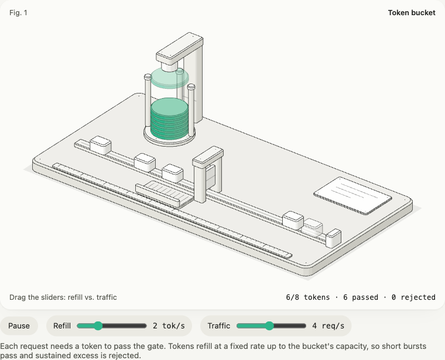

# isofig

**Explica una idea técnica como una pequeña máquina bien hecha con la que se puede jugar.**
SVG isométrico generado al compilar, un runtime de 1,7 KB, adaptadores para Astro y Angular, y una skill de
Claude Code que escribe la figura por ti.

[English](README.md) · [Guía de Astro](docs/es/astro.md) · [Guía de Angular](docs/es/angular.md) ·
[Referencia de la spec](docs/es/spec.md) · [Créditos](NOTICE.md)



<sub>`examples/token-bucket`: 40 piezas, **13 KB gzip** la figura entera. Los carritos que encuentran ficha cruzan
la compuerta; los demás van a la bandeja de rechazados.</sub>

## Por qué

Un diagrama de cajas y flechas dice *qué* tiene un sistema. Una máquina muestra *cómo funciona*: ves cómo se vacía
el tubo de fichas, subes el tráfico y la compuerta empieza a rechazar. isofig hace esas máquinas lo bastante
baratas como para ponerlas en cada página de un curso o de una documentación.

| | |
|---|---|
| **Las figuras son datos** | Una spec tipada (o JSON) con piezas, grupos que se mueven y controles. Sin código de dibujo. |
| **Ligera** | El SVG se genera antes. Coordenadas relativas en décimas, un path por tono, puntos como trazos de largo cero. Presupuesto por defecto: 40 KB gzip por figura, y `isofig check` lo hace cumplir. |
| **Movimiento sereno y veraz** | Los grupos se mueven con `transform`, nunca redibujando. Un modelo puro mueve la lectura y las piezas con los mismos números. |
| **Accesible de serie** | Botón de pausa, controles nativos con `aria-valuetext`, con `prefers-reduced-motion` arranca en pausa, nada corre fuera de pantalla. |
| **Con tema** | Todo color es una variable `--isofig-*`. Trae claro y oscuro. |
| **Auditada** | El build avisa de piezas que flotan, piezas hundidas, orden de pintado ambiguo y peso. |

## Inicio rápido (Astro)

```sh
npm i isofig
```

```astro
---
import Figure from "isofig/astro";
import balde from "../figuras/balde";
---
<Figure spec={balde} lang="es" n={1} />
```

Guía completa: [docs/es/astro.md](docs/es/astro.md).

## Inicio rápido (Angular 19+)

```sh
npm i isofig
npx isofig add angular src/app/isofig
npx isofig build figures/balde.ts --format module --lang es -o src/app/figures/balde.figure.ts
```

```ts
@Component({
  imports: [IsofigFigure],
  template: `<isofig-figure [figure]="figure" [model]="model" />`,
})
```

Guía completa: [docs/es/angular.md](docs/es/angular.md).

## Con Claude Code

Copia `skill/` a `~/.claude/skills/isofig` (o a `.claude/skills/isofig` en un proyecto) y pide:

```text
/isofig explica cómo funciona un circuit breaker, interactivo, para nuestra documentación en Astro
```

La skill inventa la máquina, escribe la spec y el modelo, corre `isofig check`, mira capturas en los dos temas e
itera.

## Importar

- **docker compose:** `docker compose config --format json | npx isofig import compose -` entrega una figura con
  un rack por servicio, réplicas, puertos, volúmenes y redes. [Guía](docs/es/importar.md).
- **Un boceto o una captura:** pásaselo a la skill de Claude Code; lee la imagen y arma la máquina.


## CLI

```text
isofig build <spec> [-o archivo] [--format html|module|json|page] [--lang es] [--n 1] [--model archivo]
isofig check <spec> [--lang es] [--strict]
isofig add angular <carpeta>
isofig import compose <archivo.json|-> [-o spec.json]
```

## Límites

- Los sólidos son prismas y cilindros (plantas convexas). En la v0.1 no hay tubos, cuerpos de revolución, shaders
  ni 3D real.
- El orden de pintado se resuelve en reposo: lo que se mueve debe recorrer zonas donde no pase detrás de otra pieza.
- Dibuja máquinas e instrumentos, no gráficos, personas ni mapas.

## Créditos

Inspirada en [anatomy](https://github.com/wheresryan22/anatomy) de @wheresryan22 (MIT). Ver [NOTICE.md](NOTICE.md).

## Licencia

[MIT](LICENSE)
