# isofig

**Interactive 3D machines, maps and diagrams as pure SVG. No WebGL. No renders. No images.**

Describe a machine, a network or a UML model as (nested) JSON. isofig draws it in isometric 3D at build time,
brings it to life with a 4.3 KB runtime, takes it apart piece by piece and zooms the camera onto the part you pick,
without you writing a single function. It is not only for software: the same JSON draws a car or a skeleton. It ships
with Astro and Angular adapters, and with a Claude Code plugin that writes, checks and looks at the figures for you.

[Español](README.es.md) · [Beyond software](#beyond-software) · [Gallery](#gallery) · [Quick start](#quick-start) ·
[Claude Code plugin](#claude-code-plugin) · [Docs](#documentation) · [Credits](NOTICE.md)

<p align="center">
  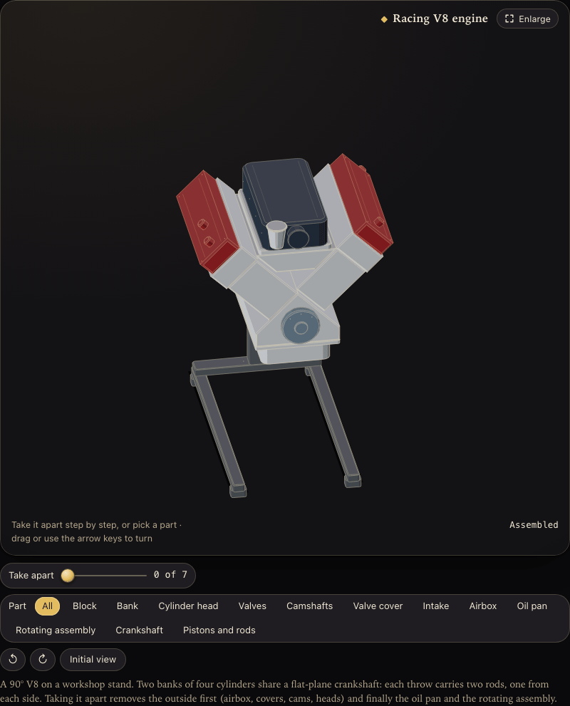
  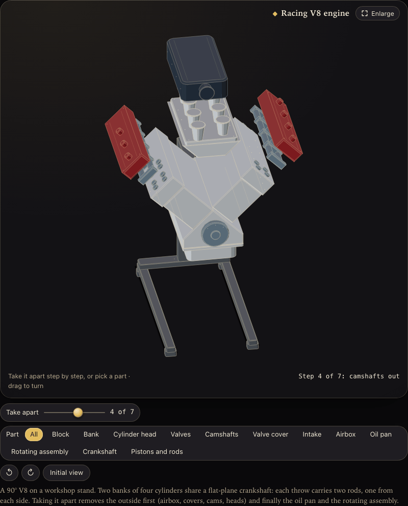
  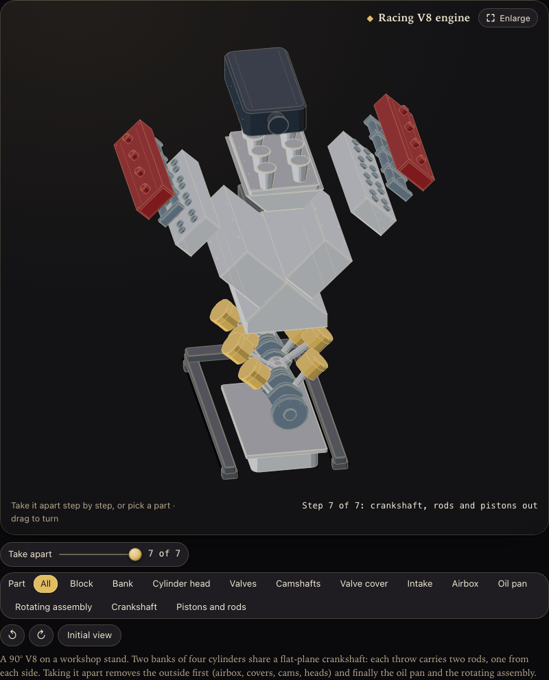
</p>

<p align="center"><sub><code>examples/motor-v8/spec.json</code>: 215 parts in plain JSON, <b>16.4 KB gzip</b> for the whole
figure. The "Take apart" slider, the parts list and the step readout come from the nesting of the JSON: there is no
model and no code. Shown in the optional <a href="docs/en/luxe.md">luxe style</a>.</sub></p>

---

## Why isofig

A diagram with boxes and arrows says *what* a system has. A machine shows *how it works*: you watch a cache miss go
down to the database, you push the traffic slider and the gate starts rejecting, you take the engine apart and see
what sits under the heads. isofig makes those machines cheap enough to put on every page of a course, a docs site or
a landing page.

| | |
|---|---|
| **No renders, no WebGL** | The figure is SVG generated at build time from 3D geometry. There is nothing to render, record or host. |
| **Light** | Runtime 4.3 KB gzip. A complete figure weighs 7–35 KB gzip. The 360° turn (10 KB) and the enlarge dialog (0.8 KB) download only when someone uses them. |
| **Works without JavaScript** | The page already contains the drawing. With JS it animates; without it, it is still a figure. |
| **Readable by search engines and screen readers** | Titles, labels and descriptions are real text in the HTML, not pixels in a video. |
| **Accessible by default** | Pause button, native controls, `prefers-reduced-motion` (followed live), a polite live region, a focus-trapped enlarge dialog, contrast measured on every color. |
| **Figures are data** | A typed spec or plain JSON. It diffs well in git, reviews well in a pull request and can be written by people or by an AI. |
| **Validated** | `isofig check` finds broken references, values off their step, controls that do nothing, labels too small to read and colors that can't be told apart, each with a JSON path and a stable code. |

### How it compares

Measured, not guessed: the weights are the minified, gzipped JavaScript each option sends to the browser.

| | isofig | Three.js / WebGL | Video or GIF render | Mermaid | Lottie |
|---|---|---|---|---|---|
| JS sent to the browser | **4.3 KB** runtime | 167 KB (core only) | none, but megabytes of video | 726 KB | 74 KB |
| Shows something without JS | **Yes** | No | Yes | No | No |
| Text indexable and read aloud | **Yes** | No | No | Yes | No |
| The reader can play with it | **Yes**: sliders, toggles, presets, teardown | Yes, if you code it | No | No | No |
| Zoom onto one part of the model | **Yes**: pick a name and the camera goes there | Yes, if you code it | Only what you rendered | No | No |
| Source you can diff and review | **JSON** | Code | Binary | Text | Exported JSON |
| Free camera, real lighting | A full 360° turn by drag or arrow keys, with inertia; flat shading | **Yes** | Whatever you rendered | No | No |

isofig is not a 3D engine: for a free camera, physics or photorealism, use Three.js. isofig is for **explaining**:
a figure that loads instantly, reads like an illustration and lets the reader break the system on purpose.

---

## What makes it different

1. **The object is the explanation.** A rate limiter is a coin tube and a gate. A cache is a pin-tumbler lock. A
   queue is a conveyor. A class is a filing cabinet with drawers. isofig is built for real, recognisable objects,
   not floating boxes.
2. **Nested JSON gives you the teardown for free.** Write the engine as a tree (block → banks → heads → valves) and
   add `explode` to the nodes. isofig adds a stepped "Take apart" slider, a parts list and a readout per step. Every
   node also has its three axes, like a Unity Transform: `at` for position and `rotate: [x, y, z]` to tilt a door, an
   arm or a connecting rod with everything inside it, and the figure turns a full 360° by drag or arrow keys.
   [Guide](docs/en/nesting.md).
3. **Pick a part and the camera goes to it.** In a figure that comes apart, every named node becomes an entry in the "Part" list. Choose one and
   the view travels to it with an animation, the part is painted in front of everything (even when it sits inside
   another), the rest stays at 35 % so you keep your bearings, and its note appears in the readout. "All" returns to
   the full frame, and the zoom follows the part when you take the figure apart or turn it. You write no camera code:
   it comes from the `name` of your nodes. [Guide](docs/en/nesting.md#the-teardown).
4. **Maps made of objects.** Topologies, flow maps and UML class diagrams, with phones, racks, databases as stacks
   of disks, queues as conveyors and packets that travel along the routes. Import them from Mermaid or from
   `docker compose`. [Guide](docs/en/maps.md).
5. **Color with guarantees.** Seven roles for maps and nine materials for machines (steel, copper, lacquer,
   carbon…), in OKLCH, with measured guarantees in light and dark: engraved text ≥ 4.5:1, edges ≥ 3:1, and every
   pair of colors distinguishable, including with protanopia, deuteranopia and tritanopia. Derive them from your
   brand color with one command. [Guide](docs/en/color.md).
6. **"Try to break it".** Presets set several controls at once (and can press buttons), so the reader sees the
   failure the lesson is about: the circuit breaker trips, the queue overflows, the replica falls behind.
7. **An AI that draws and then looks.** The Claude Code plugin invents the machine, writes the spec, runs
   `isofig check`, takes screenshots at phone and desktop width in both themes, looks at them and iterates.

---

## Beyond software

The teardown is not about code. Anything made of parts that fit together can be an isofig figure, with the same
slider, the same parts list and the same zoom. The repository ships two demos from outside software, both in plain
JSON with names and notes in English and Spanish.

<p align="center">
  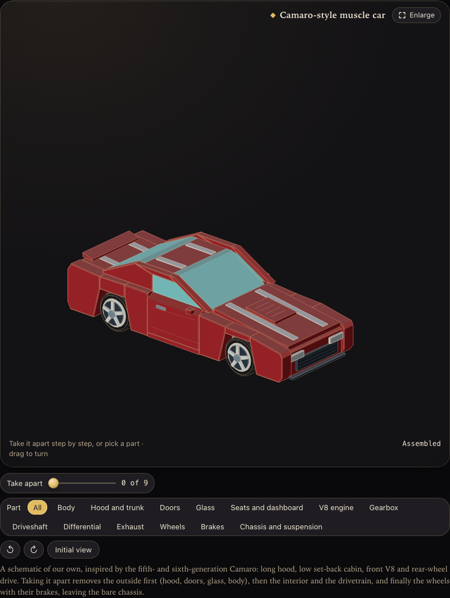
  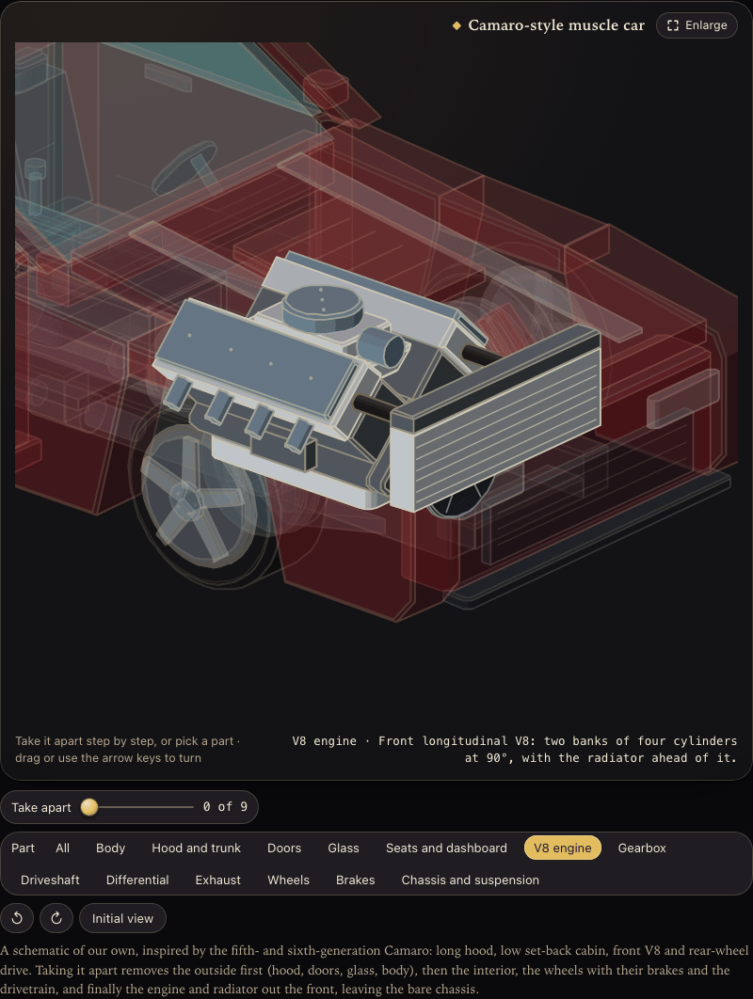
  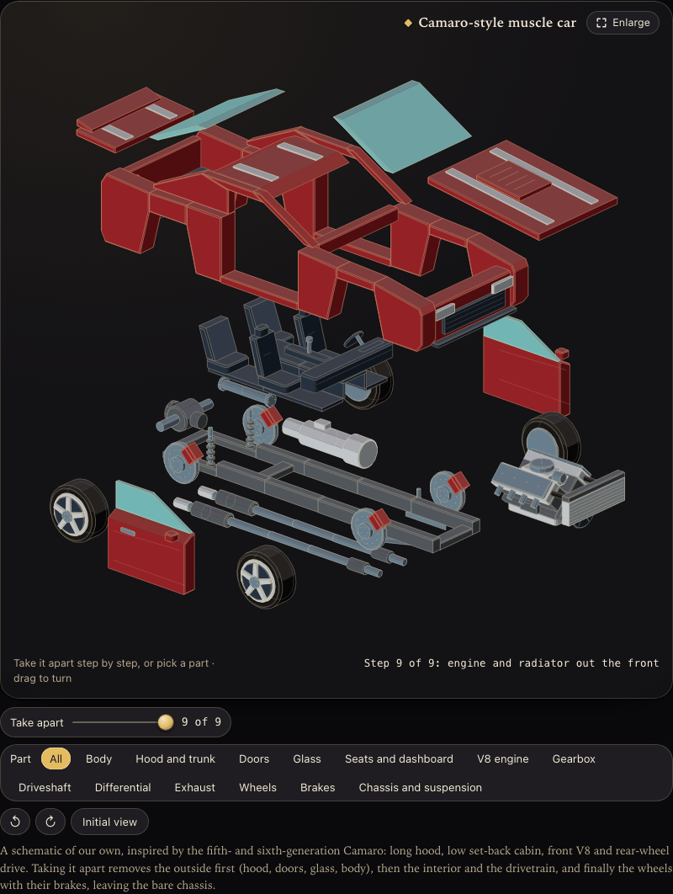
</p>

<p align="center"><sub><code>examples/muscle-car/spec.json</code>: a Camaro-style muscle car, a schematic of our own with no logos.
13 named parts and 9 steps, <b>27.4 KB gzip</b>. Hood, doors and glass come off first, then the interior, the wheels and
the drivetrain, and the V8 leaves out the front last, leaving the bare chassis. Pick "V8 engine" and the camera goes in.</sub></p>

<p align="center">
  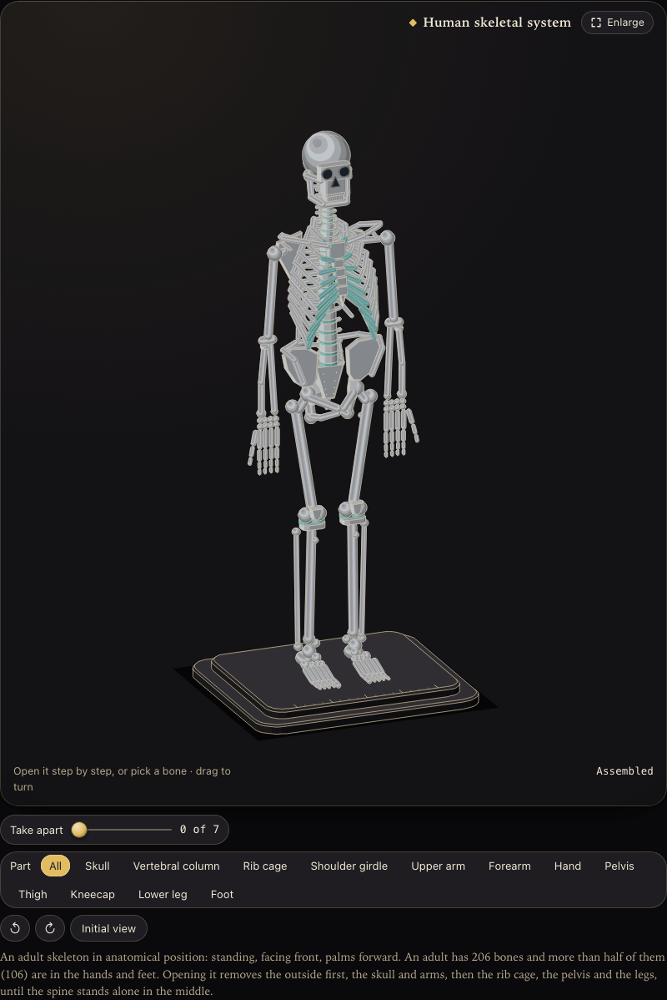
  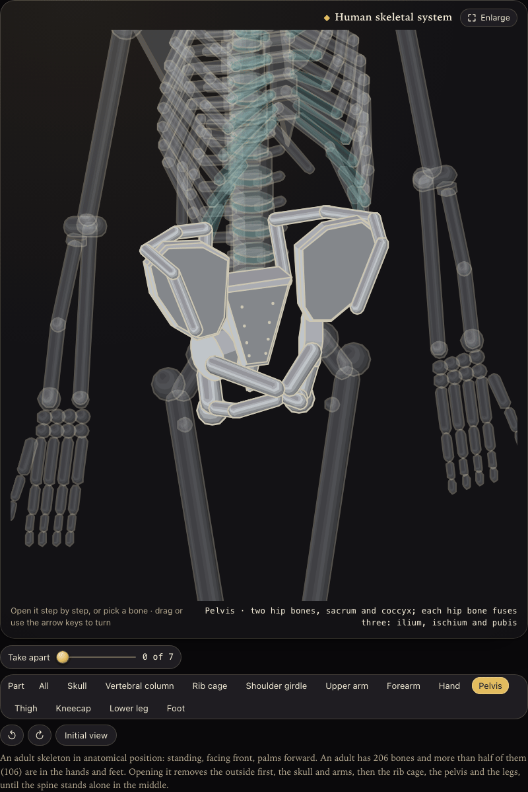
  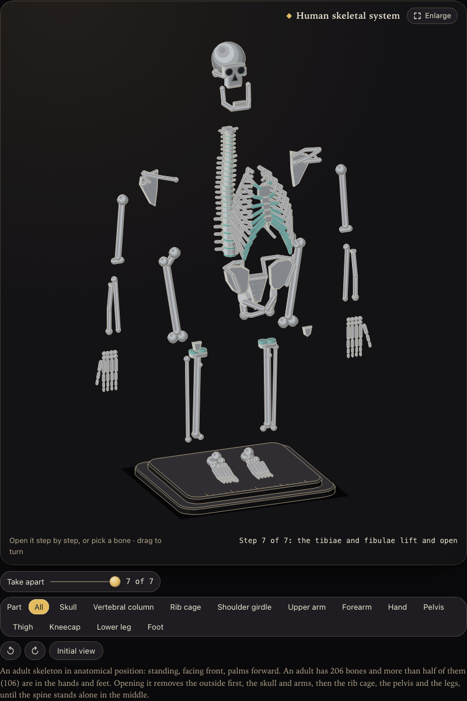
</p>

<p align="center"><sub><code>examples/sistema-oseo/spec.json</code>: the human skeleton, with a real anatomical note on every part
(an adult has 206 bones, and 106 of them are in the hands and feet). 12 named parts and 7 steps, <b>33.9 KB gzip</b>.
A teaching schematic, not a medical atlas. Pick "Pelvis" or "Hand" and read what the readout says.</sub></p>

Where it fits:

| Field | What you would draw | What the reader gets |
|---|---|---|
| **Workshops and manufacturing** | An engine, a gearbox, a pump, a machine tool, an assembly sequence | A manual or a parts catalog they operate: take it apart in the order the real thing comes apart, and zoom into the part they must replace |
| **Medicine and anatomy** | A skeleton, a joint, an organ system | A study aid where each name carries its note, and picking "Pelvis" takes the student to it |
| **Chemistry** | Atoms and molecules | `sphere` for atoms and `capsule` for bonds, the two solids added in 0.10. No molecule ships as an example yet |
| **Education** | A cell, a flower, a camera, a lock: whatever a class takes apart | One JSON, one slider and one list of parts to zoom into, with no video to record or host |

The recipe is the same as for the V8: a tree of named parts, an `explode` on each, one `note` per entry. Spheres and
capsules ([solids reference](docs/en/spec.md#solid-parts)) give you the round parts that bones and joints need. A good
entry is one worth zooming into: name a rod or a lid, not a screw. Or ask the plugin to draw it for you
([plugin](#claude-code-plugin)).

---

## Gallery

| | |
|---|---|
| 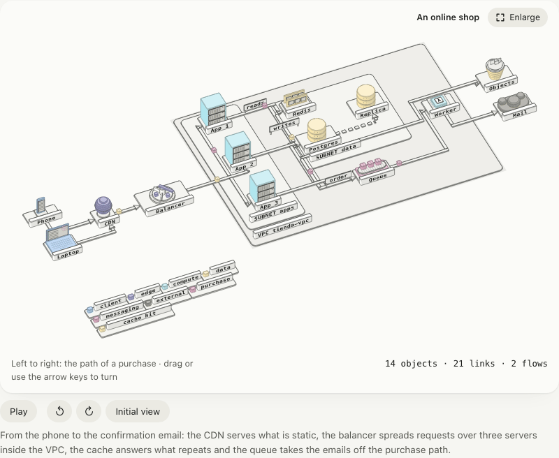 | 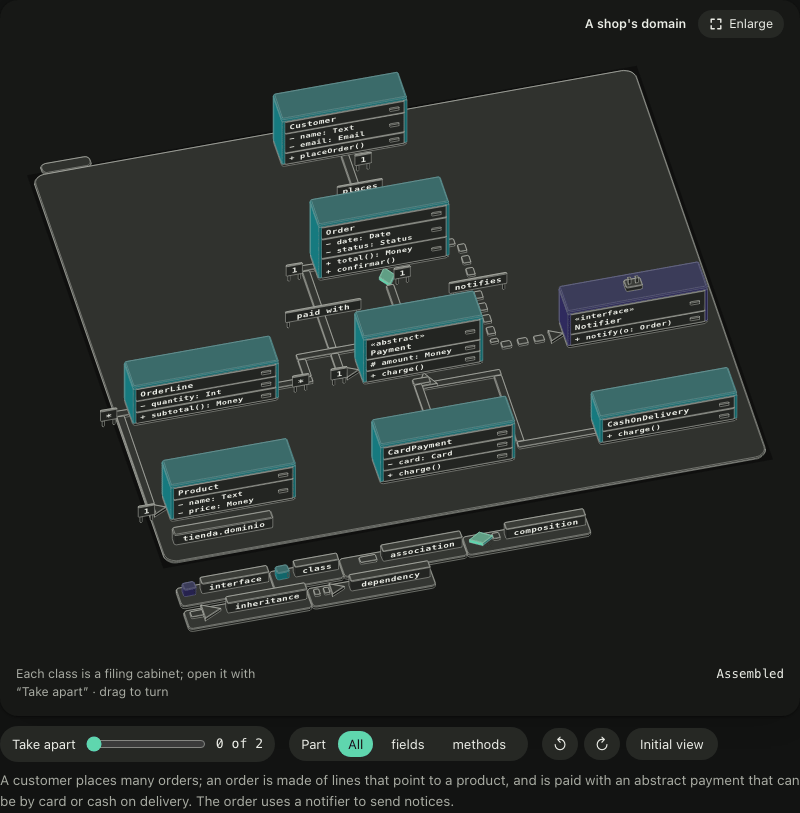 |
| **Topology** · `examples/mapa-tienda` · two animated flows: a purchase and a cache hit | **UML** · `examples/mapa-uml` · inheritance, composition, multiplicities; the drawers open with "Take apart" |
| 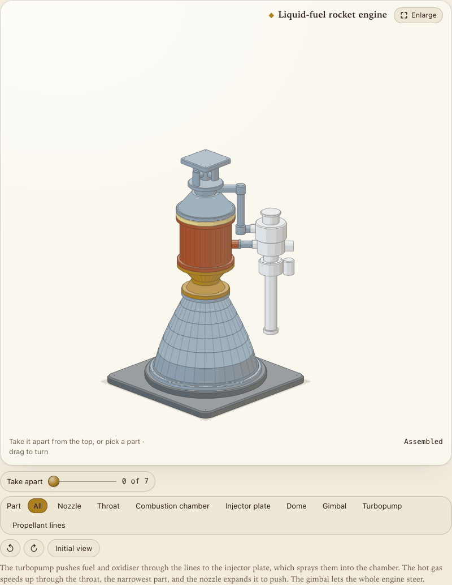 | 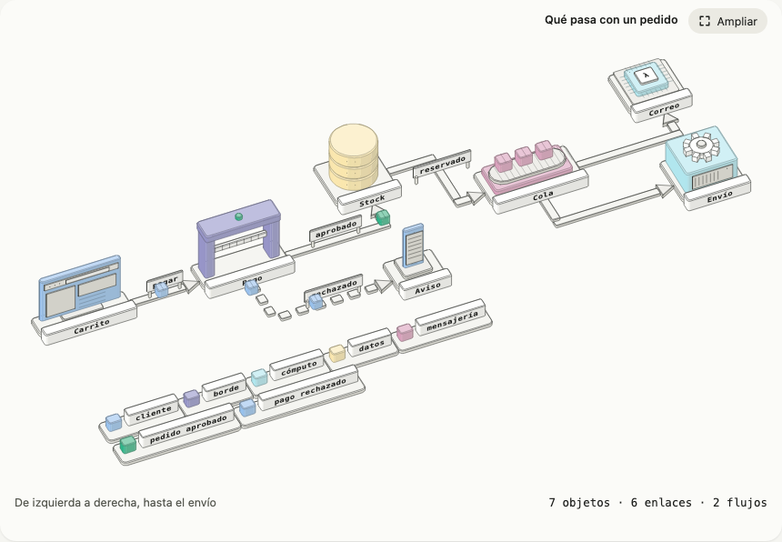 |
| **Assembly** · `examples/motor-cohete` · turbopump, injector, chamber, nozzle and gimbal | **Flow map** · `examples/mapa-pedido` · cart, payment, stock, queue, email, shipment |
| 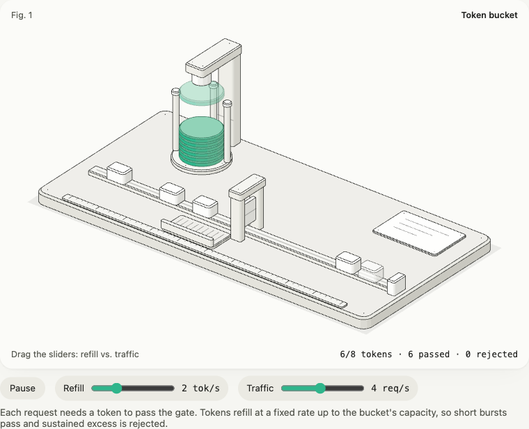 |  |
| **Machine with a model** · `examples/token-bucket` · 40 parts, 7.3 KB gzip | **Imported** · `examples/compose` · from `docker compose config --format json` |

More in [Beyond software](#beyond-software): a muscle car and a human skeleton. `npm run gallery` puts every example in
a single offline HTML file, in both styles and both themes.

---

## Quick start

### 1. Install

```sh
npm i github:ACHAVESTA-Git/ISOFIG#v0.10.0
```

Node 22.18 or later. The package builds itself on install. The name `isofig` on the npm registry does not belong to this project yet: until it is published there, install only from this repository.

### 2. Write a figure as JSON

```json
{
  "id": "lidded-box",
  "title": { "en": "A box with a lid", "es": "Una caja con tapa" },
  "root": {
    "id": "box",
    "parts": [{ "id": "base", "kind": "box", "at": [0, 0, 0], "size": [60, 60, 20], "radius": 4, "paint": "steel", "shadow": true }],
    "children": [{
      "id": "lid", "name": { "en": "Lid", "es": "Tapa" }, "at": [0, 0, 20], "explode": [0, 0, 30],
      "parts": [{ "id": "slab", "kind": "box", "at": [0, 0, 0], "size": [60, 60, 6], "radius": 4, "paint": "lacquer" }]
    }]
  }
}
```

### 3. Check it and preview it

```sh
npx --no-install isofig check box.json --strict
npx --no-install isofig build box.json --format page -o box.html   # open box.html: the "Take apart" slider is already there
```

### 4. Put it on a page

**Astro**

```astro
---
import Figure from "isofig/astro";
import box from "../figures/box.json";
---
<Figure spec={box} lang="en" orbit />
```

The theme CSS is inlined once, only on pages that draw a figure. The runtime, the model, the orbit and the enlarge
dialog download when the reader gets close or uses them. [Astro guide](docs/en/astro.md).

**Angular 19+** (standalone, signals, zoneless)

```sh
npx --no-install isofig add angular src/app/isofig
npx --no-install isofig build figures/box.json --format module -o src/app/figures/box.figure.ts
```

[Angular guide](docs/en/angular.md).

**Any other site**: `isofig build --format html` gives you the `<figure>` markup. Load `isofig/theme.css` and call
`mountAll()` from `isofig/runtime`.

---

## The four kinds of figure

| You want to show… | Write | Guide |
|---|---|---|
| A mechanism that runs over time (a limiter, a cache, a retry with backoff) | `parts` and a small pure **model** | [spec.md](docs/en/spec.md) |
| Something that moves with a control, with no logic | `parts` and `bind` or `tracks` | [spec.md](docs/en/spec.md) |
| How a thing is built (an engine, a car, a skeleton, a server) | a nested **`root`** with `explode` | [nesting.md](docs/en/nesting.md) |
| How things connect (a network, a flow, a domain model) | a **`map`** | [maps.md](docs/en/maps.md) |

### A map in a dozen lines

```json
{
  "id": "minimal-map",
  "title": { "en": "An order", "es": "Un pedido" },
  "map": {
    "nodes": [
      { "id": "web", "is": "browser", "name": "Shop" },
      { "id": "api", "is": "service", "name": "API" },
      { "id": "db", "is": "database", "name": "Postgres" }
    ],
    "links": [{ "from": "web", "to": "api", "label": "order" }, { "from": "api", "to": "db" }],
    "flows": [{ "path": ["web", "api", "db"], "label": "one order" }]
  }
}
```

Already have Mermaid? `npx --no-install isofig import mermaid diagram.mmd -o map.json`.

### A model in a few lines

```ts
import type { Model } from "isofig/runtime";

const bucket: Model<{ coins: number }, { refill: number }> = {
  init: () => ({ coins: 8 }),
  step: (s, dt, p) => ({ coins: Math.min(8, s.coins + p.refill * dt) }),
  view: (s, _p, ctx) => {
    if (s.coins < 1) ctx.say("The bucket is empty: requests are rejected");
    return { readout: `${Math.floor(s.coins)}/8 coins`, groups: { gate: { s: s.coins < 1 ? "fail" : "ok" } } };
  },
};
export default bucket;
```

Models are pure functions. The runtime takes care of the clock, pausing offscreen, reduced motion (`motion.settle`),
announcements without repetition (`ctx.say`) and buttons (`ctx.pressed`).

---

## Color

```jsonc
{ "id": "pipe", "kind": "cylinder", "paint": "copper" }  // a material, on a part or a node
{ "id": "db", "is": "database", "paint": "data" }        // a role, on a map node
```

```sh
npx --no-install isofig palette --base "#e2231a" --report   # roles derived from your brand color, with the contrast table
```

The `lit` tone stays the one strong accent of a figure. `check` warns when a figure uses more than six colors, when
two of them can't be told apart, or when engraved text lacks contrast. [Color guide](docs/en/color.md) ·
[Theme guide](docs/en/theme.md).

### Luxe style (optional)

```js
import "isofig/theme.css";
import "isofig/themes/luxe.css";
```

```html
<div class="isofig-luxe">… your figures …</div>
```

*Atelier* (warm ivory, espresso ink, brass) in light mode and *Nocturne* (black lacquer, champagne hairlines, gold)
in dark mode. 1.7 KB gzip, no web fonts, the same contrast and color-blindness guarantees. [Guide](docs/en/luxe.md).

---

## Claude Code plugin

```sh
claude plugin marketplace add ACHAVESTA-Git/ISOFIG
claude plugin install isofig@isofig
```

Then ask, in any language:

```text
/isofig:isofig explain how a circuit breaker works, interactive, for our Astro docs
/isofig:isofig draw our checkout as a topology map with the purchase flow
/isofig:isofig a rocket engine I can take apart piece by piece
/isofig:isofig a human skeleton I can take apart, with a note on every part
```

The skill picks the right kind of figure (or tells you when isofig is the wrong tool), invents the object, writes the
spec and the model, runs `isofig check --model --presets --strict`, takes screenshots at 390 and 1280 px in light and
dark, looks at them and iterates. For an assembly it also gives each entry of the "Part" list something worth zooming
into, and it knows the car and the skeleton as reference figures. [Plugin guide](docs/en/plugin.md).

---

## CLI

```text
isofig build <spec> [-o file] [--format html|module|json|page] [--lang en] [--model file] [--orbit]
isofig check <spec> [--lang en|es] [--strict] [--model file [--presets] [--seconds 12]]
isofig import compose <file.json|->      a map from `docker compose config --format json`
isofig import mermaid <file.mmd|->       a map from a Mermaid flowchart or classDiagram
isofig palette [--base "#2fb58b"] [--format css|json] [--report]
isofig add angular <dir>
isofig --version
```

## Performance

Minified and gzipped, checked on every push by `npm run size` against `size-budget.json`:

| Piece | When it loads | Size |
|---|---|---|
| `isofig/runtime` | when the reader gets close to a figure | 4.3 KB |
| `isofig/zoom` (enlarge dialog) | when the chip is pressed | 0.8 KB |
| `isofig/orbit` (360° turn) | when the figure is touched or turned | 10 KB |
| `isofig/theme.css` | inline, once per page with a figure | 3.0 KB |
| `isofig/themes/luxe.css` | if you import it | 1.7 KB |
| A figure (SVG and data) | in the HTML | 7–35 KB |

The core (`isofig`), the kit and the map compiler run at build time and are not sent to the browser.

## Accessibility

- Every figure is a `<figure>` with an SVG `role="img"`, a title and a description; maps also describe their objects
  and links in words.
- Native controls: `input[type=range]` with `aria-valuetext`, switches, radio groups and buttons. With the drawing
  focused, ← and → turn it 15° and ↑ and ↓ raise or lower the camera.
- Motion: a pause button (WCAG 2.2.2), `prefers-reduced-motion` followed live, animation that stops offscreen. With
  reduced motion the camera jumps to the part you pick instead of traveling.
- The parts list is a radio group with its legend, and the readout says which part is picked.
- Announcements through a polite live region, at most two per interaction, never over a preset note.
- "Enlarge" opens a focus-trapped dialog where labels read at 11 px or more on a phone.
- Colors: text ≥ 4.5:1, edges ≥ 3:1, roles distinguishable with color blindness, and color is never the only carrier
  of meaning (maps get a legend).

## Compatibility

Node 22.18+ · Astro 5 and 7 (built in CI) · Angular 19+ · evergreen browsers (checked in Chromium and WebKit).

## Documentation

| English | Español |
|---|---|
| [Spec reference](docs/en/spec.md) (solids from box to sphere and capsule) | [Referencia de la spec](docs/es/spec.md) (sólidos, de la caja a la esfera y la cápsula) |
| [Nested specs, teardown and zoom to a part](docs/en/nesting.md) | [Anidar, desarmar y acercarse a una pieza](docs/es/anidar.md) |
| [Maps: topologies, flows and UML](docs/en/maps.md) | [Mapas](docs/es/mapas.md) |
| [Color](docs/en/color.md) · [Theme](docs/en/theme.md) · [Luxe](docs/en/luxe.md) | [Color](docs/es/color.md) · [Tema](docs/es/tema.md) · [Lujo](docs/es/lujo.md) |
| [Kit of common parts](docs/en/kit.md) | [Kit de piezas](docs/es/kit.md) |
| [Validation](docs/en/validate.md) | [Validar](docs/es/validar.md) |
| [Astro](docs/en/astro.md) · [Angular](docs/en/angular.md) | [Astro](docs/es/astro.md) · [Angular](docs/es/angular.md) |
| [Importers](docs/en/import.md) · [Claude Code plugin](docs/en/plugin.md) | [Importar](docs/es/importar.md) · [Plugin](docs/es/plugin.md) |

Design decisions: [ADR 0001](docs/adr/0001-nucleo-ligero-y-especificacion-declarativa.md) (a light core, figures as
data), [ADR 0002](docs/adr/0002-especificacion-anidada-y-despiece.md) (nested spec and teardown),
[ADR 0003](docs/adr/0003-mapas-con-objetos-reales.md) (maps made of real objects).

## FAQ

**Is it real 3D?** The geometry is 3D (boxes, cylinders, cones, prisms, spheres and capsules, along any axis) and is
projected, shaded and depth-sorted at build time. The figure turns a full 360° by drag or arrow keys, and the browser
redraws it from every angle. Every node also turns on its three axes with `rotate`, like a Unity Transform. What it
leaves out on purpose is physics, textures and photorealism: that keeps the figure light and readable.

**Is it only for software?** No. The same JSON draws a car or a skeleton: see [Beyond software](#beyond-software).
Anything made of parts that fit together, from an engine to a bone, works the same way.

**Do I have to code the zoom onto a part?** No. It comes from the `name` of the nodes of a figure that comes apart:
the "Part" list is built from them, and picking one moves the camera to it. Give each entry a `note` and the readout
shows it.

**Do I need a framework?** No. Astro and Angular get components; any site can use the `<figure>` markup from
`isofig build` and the runtime.

**Can I use my brand colors?** Yes: override the `--isofig-*` CSS variables with one `.isofig { … }` rule, or derive
the map roles from your color with `isofig palette --base`.

**How big can a map get?** About twenty nodes per figure read well; beyond that, `check` suggests splitting it.

**Can an AI write the figures?** That is what the plugin is for. A figure is data with stable validation codes, so the
AI can check its own work and fix it.

## Roadmap

- 1.0: the warnings marked ↑ in the [validation guide](docs/en/validate.md) become errors, and the package goes to npm.
- Teardown with rotation: hinges that swing open as the figure comes apart (a door, a hood); today teardown only translates.
- More map objects and importers (OpenAPI, Kubernetes manifests).
- Adapters for other frameworks.

## Contributing

```sh
npm ci
npm run check && npm test && npm run build && npm run size
```

Snapshots of every example live in `test/snapshots/`. Update them with `UPDATE_SNAPSHOTS=1 npm test` when a change to
the drawing is intended.

## Credits

Inspired by [anatomy](https://github.com/wheresryan22/anatomy) by @wheresryan22 (MIT). No code was copied: the ideas
were rewritten. See [NOTICE.md](NOTICE.md).

## License

[MIT](LICENSE)
