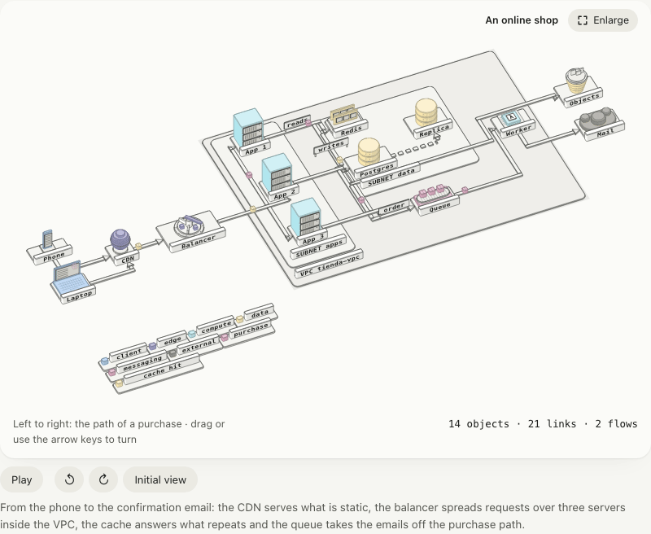
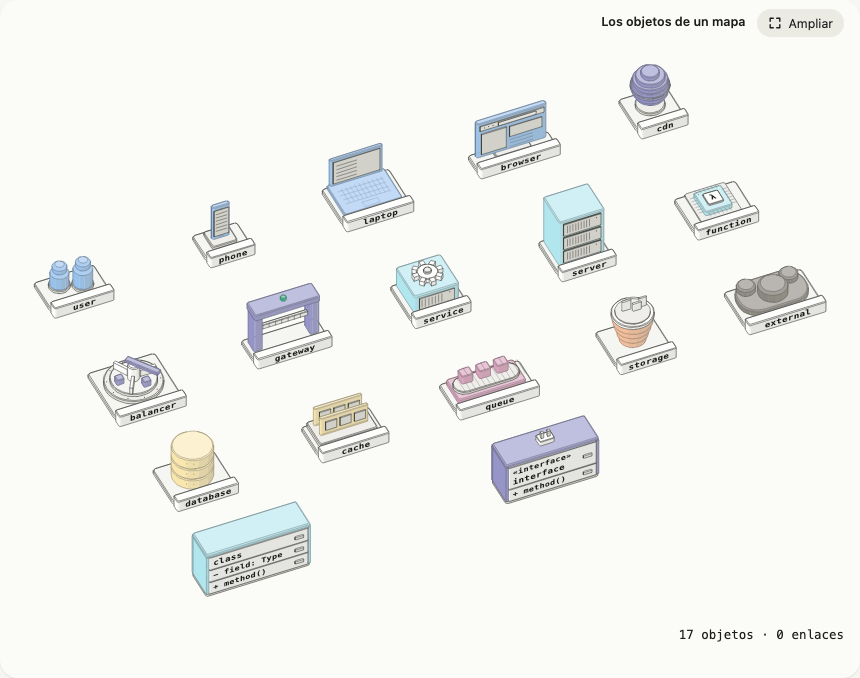
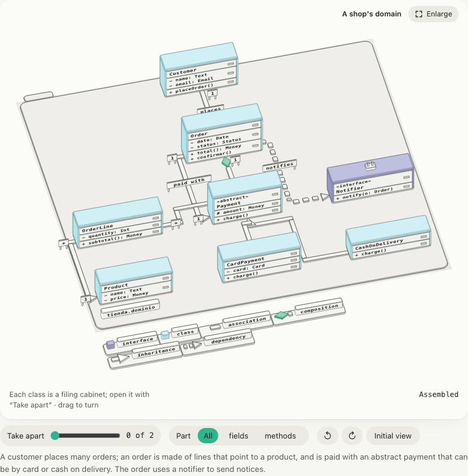
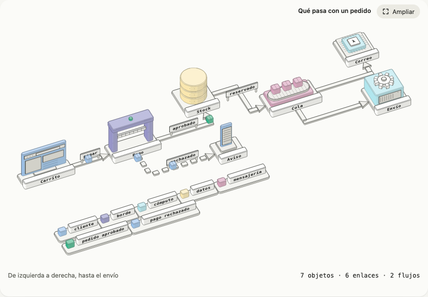

# Maps: topologies, flows and UML

A map explains how things connect (a network, an order travelling from the shop to the shipment, the classes of a
domain) without drawing boxes and arrows. **Every node is a small, recognisable object**: a phone on its stand, a rack,
a database as a stack of disks, a queue as a conveyor belt with parcels, a load balancer as a carousel, a class as a
filing cabinet with drawers. You write it as nested JSON, with examples that make sense, and isofig lays it out, runs
the ribbons across the floor, puts on the UML ends and makes the packets travel.



```json
{
  "id": "minimal-map",
  "title": { "es": "Un pedido", "en": "An order" },
  "map": {
    "nodes": [
      { "id": "web", "is": "browser", "name": "Shop" },
      { "id": "api", "is": "service", "name": "API" },
      { "id": "db", "is": "database", "name": "Postgres" }
    ],
    "links": [
      { "from": "web", "to": "api", "label": "order" },
      { "from": "api", "to": "db" }
    ],
    "flows": [{ "path": ["web", "api", "db"], "label": "one order" }]
  }
}
```

`isofig build map.json --format page` draws it as is, and so do `isofig check` and Astro's `<Figure>`; `validateSpec`
checks it without compiling it. If you call `renderFigure` yourself, give it the compiler: `import { resolveMap } from
"isofig/map"` and `renderFigure(spec, { resolveMap })` (without it the `map` is the `map-compiler-missing` error: that
way the core does not load ~20 KB when nobody draws a map). The full bilingual examples are in `examples/`: [`mapa-tienda`](../../examples/mapa-tienda/spec.json)
(an online shop with VPC, subnets, cache, replica, queue and two flows), [`mapa-pedido`](../../examples/mapa-pedido/spec.json)
(from the cart to the shipment, with the rejected-payment branch) and [`mapa-uml`](../../examples/mapa-uml/spec.json)
(a shop's domain).

## The shape of the JSON

| `map` field | What for |
|---|---|
| `nodes` | The nodes: an object from the catalog, or a container with `children`. |
| `links` | The ribbons between nodes. |
| `flows` | The packets that travel along those ribbons. |
| `layout` | `flow` (default), `layers` or `grid`: how nodes are laid out. |
| `legend` | `false` removes the legend. By default it shows when there is more than one colour, a flow or a UML link. |
| `labelSize` | Fixes the label size (world units) instead of letting it fit itself. |

The rest of the figure (`id`, `title`, `hint`, `caption`, `alt`, `width`, `height`, `camera`) is as usual. A map sets for
you the size (1150 wide), the camera that suits its layout, a readout («14 objects · 21 links · 2 flows») and a
description for screen readers with the objects and what links to what: whatever you write in the spec wins.

### Nodes

| Field | What for |
|---|---|
| `id` | Unique in the whole map (also inside containers). |
| `is` | An object from the catalog (below). In a container it is its tag: `region`, `vpc`, `subnet`, `cluster`, `package`… |
| `name` | The engraved label, a `Text` (`"Redis"` or `{ "es": …, "en": … }`). Defaults to the `id`. |
| `children` | Makes the node a container: a tray with its plate, as big as what it holds. |
| `paint` | A colour role (`client`, `edge`, `compute`, `data`, `messaging`, `storage`, `external`) instead of the object's own. |
| `layout` | How a container lays out its children; defaults to the map's. |
| `cell` | In `grid`: `[column, row]`. |
| `rank` | In `flow` and `layers`: forces the rank (the column or level). |
| `fields`, `methods`, `abstract`, `stereotype`, `explode` | UML classes and interfaces: see below. |

### The catalog



| `is` | It is… | Role |
|---|---|---|
| `user`, `phone`, `laptop`, `browser` | two chess people; a phone on its stand; an open laptop; a browser window | `client` |
| `cdn`, `balancer`, `gateway` | a globe on its foot; a sorting carousel; a gate with a barrier | `edge` |
| `service`, `server`, `function` | a box with a gear on top; a three-unit rack; a chip with a λ | `compute` |
| `database`, `cache` | a stack of disks; two memory modules in their socket | `data` |
| `queue` | a conveyor belt with parcels | `messaging` |
| `storage` | a bucket with files sticking out | `storage` |
| `external` | a cloud | `external` |
| `class`, `interface` | a filing cabinet with name, attribute and method drawers; the same with a plug on top | `compute`, `edge` |

Each object stands on a plinth with a neutral-tone plate where its name is engraved; classes carry their name in the
first drawer. An `is` that is not in the catalog is an error (`map-glyph-unknown`), except in a container.

### Containers

A node with `children` is a **low tray** with its plate («VPC shop», «SUBNET apps»): the class in capitals and the name.
Its size comes from its children and every nesting level raises one tone step, so you see what holds what. `package`
adds the UML folder tab and does not repeat its class on the plate. A ribbon that crosses a tray runs over the highest.

```json
{ "id": "vpc", "is": "vpc", "name": "shop-vpc", "children": [
  { "id": "apps", "is": "subnet", "name": "apps", "children": [
    { "id": "app-1", "is": "server", "name": "App 1" },
    { "id": "app-2", "is": "server", "name": "App 2" }
  ] }
] }
```

## Layouts

- **`flow`**: left to right by rank. A node's rank is the longest path to it along the links (a cycle is cut where it
  closes); the nodes of one rank stack toward the reader and are ordered so ribbons cross as little as possible. `rank`
  forces it.
- **`layers`**: top to bottom. Inheritance (`inherits`, `implements`) puts the parent on top; composition and
  aggregation, the whole; anything else, the origin. Siblings of a level sit side by side. It is the UML one.
- **`grid`**: explicit cells, `cell: [column, row]` (the column grows to the right; the row, toward the reader). A node
  without `cell` takes the first free cell; two in the same cell warn (`map-cell-collision`) and the second moves.

A tall object hides what is behind it: nodes are spaced as far apart as needed so the one in front does not cover the
label of the one behind. A container may use a different layout from the map's (`layout` on the node).

The default camera of each layout looks from the front and a little from the left (`flow` and `grid`: azimuth −24°,
elevation 44°; `layers`: −14°, 46°), so you see the front and the side the arrows come in by. Change it with `camera` as
in any figure.

## Links

`{ "from": "a", "to": "b" }`. `from` and `to` take an `id` or a list (`"to": ["app-1", "app-2"]` makes two ribbons); the
label and the multiplicities go on the first.

| Field | What for |
|---|---|
| `label` | A standing sign over the ribbon, at the clearest spot. |
| `kind` | `link` (default: an arrow from `from` to `to`) or a UML link. |
| `arrow` | `end` (the head at `to`), `start` (at `from`), `both` or `none`; replaces the one from `kind`. |
| `dashed` | A dashed ribbon. |
| `mult` | UML: multiplicity next to each end, `["1", "*"]`. |
| `paint` | Paints the ribbon with a role. |

| `kind` | Drawn as | Placement in `layers` |
|---|---|---|
| `link` | arrow toward `to` | `from` first |
| `inherits` | **hollow** triangle at `to` (the parent), always entering by its front | `to` on top |
| `implements` | the same, with a dashed ribbon | `to` on top |
| `composes` | **filled** diamond at `from` (the whole) | `from` on top |
| `aggregates` | hollow diamond at `from` | `from` on top |
| `depends` | arrow with a dashed ribbon | `from` first |
| `associates` | plain ribbon (with `arrow: "end"`, a head) | `from` first |

Ribbons are orthogonal, run over the floor and go around nodes; they leave and arrive by the side facing the target and
prefer arriving by a side you can see. Those that **share an origin or a target and are drawn the same** (for example
`"from": ["app-1", "app-2", "app-3"]`) merge into a trunk. If a ribbon finds no clear path it is drawn straight and
`map-route-blocked` says so.

### UML classes

```json
{ "id": "Order", "is": "class", "explode": true,
  "fields": ["- date: Date", "- status: Status"],
  "methods": ["+ total(): Money", "+ confirm()"] }
```

`fields` and `methods` are engraved in the attribute drawer and the method drawer (without them the drawer does not
exist). `abstract: true` engraves `«abstract»` over the name; `is: "interface"` (or a `stereotype`) does the same with
`«interface»` and puts a plug on top. With `explode: true` the **«Take apart»** control opens the drawers (attributes
first, then methods), and the «Part» list lets you pick «fields» or «methods» across all classes at once.



## Flows

```json
{ "id": "purchase", "path": ["phone", "cdn", "lb", "app-1", "queue"], "label": "purchase", "every": 3, "paint": "messaging" }
```

A flow walks the nodes of `path` in order, **along the ribbon of each hop** (if two consecutive nodes have no link, one
is created). What travels are packets, evenly spaced about `every` seconds apart (adjusted so they come out equal);
`speed` is world units per second (80 by default), `delay` the seconds the first one waits and `paint` its colour
(without it, the accent). The packet switches off while it goes through an object and shows up again on the other side.
Each packet is a group with its own path: they are the spec's [`tracks`](spec.md#tracks). The pause button stops them
and with reduced motion they rest halfway along and in sight.



## Colour, legend and labels

- **Each object brings its colour role** (catalog table), and the legend at the front of the map names the ones that
  appear, the flows with their packet and, in UML, the ends. Colour is never the only carrier of meaning: every object has
  its shape and its name on a neutral-tone plate.
- **The palette asks for at most six colours** (greys count as one) and for no pair to be confusable with colour
  blindness (see [color.md](color.md)). A map using all seven roles warns: group roles with `paint` (say object storage
  as `data`) or leave one grey. Packets may use the colour of a role that is already in the map.
- **Ribbons and heads are not painted**: neutral tones, an arrow's head in the darkest, inheritance hollow and only the
  filled diamond in the accent.
- **Labels fit themselves**: the compiler looks for the smallest size that makes the text about 10 px in the enlarged
  view («Enlarge», at about 1150 px). At 390 px a map is not readable and does not try to be. With too many nodes for
  one figure the size cannot get there and it warns (`map-label-small`): split the map in two.

## Import

```sh
docker compose config --format json | npx --no-install isofig import compose - -o stack.json
npx --no-install isofig import mermaid diagram.mmd -o map.json      # or "-" to read standard input
```

**Mermaid.** A subset of `flowchart` / `graph` and `classDiagram`:

| In Mermaid | In the map |
|---|---|
| `flowchart LR`, `graph TD` | `layout: flow` (`RL` too) or `layers` (`TB`, `BT`) |
| `A[Text]`, `A(…)`, `A([…])`, `A{…}`, `A((…))`, `A[(…)]`, `A>…]` | a node whose object its label suggests (Postgres → database, Redis → cache, Kafka → queue, S3 → bucket…); without a hint, the shape (`[( )]` database, `(( ))` person, `{ }` gate, `>` queue); otherwise `service` |
| `-->`, `---`, `-.->`, `==>`, `<-->`, `-->\|text\|`, `-- text -->` | a link (with `arrow`, `dashed` and `label`) |
| `A --> B & C`, `A & B --> C` | one link per pair |
| `subgraph id [Title] … end` | a container |
| `class A { +field  +method() }`, `A : +field`, `<<interface>>`, `<<abstract>>` | a class or interface with its drawers (whatever has `(` is a method) |
| `A <\|-- B`, `A *-- B`, `A o-- B`, `A --> B`, `A ..> B`, `A ..\|> B`, `A "1" --> "*" B : text` | `inherits`, `composes`, `aggregates`, `associates`, `depends`, `implements`, with multiplicities and label |

Everything else (styles, `click`, `classDef`, sequence diagrams…) is skipped and the CLI lists it under `skipped:`. `RL`
and `BT` are drawn as `LR` and `TD`. From code, `fromMermaid(text)` from `isofig/map` returns the spec and `fromMermaidDetailed(text)`
also the skipped lines.

**docker compose.** Each service is the object its image suggests (`postgres` → database, `redis` → cache, `nginx` →
load balancer, `worker` → function, anything else → service), `depends_on` are ribbons from what needs to what it needs,
published ports come in from an «Internet» globe with their `8080→80`, and each named volume is a bucket a dotted
ribbon points to. Replicas go in the label («api ×3»). It is a plain spec: edit it.


## Validation and limits

`validateSpec` checks the `map` with `map-*` codes: repeated node ids, links or flows to nodes that do not exist, an
unknown `is`, a layout, link kind or paint that does not exist, and repeated cells ([validate.md](validate.md)). With a
map, `renderFigure` adds `map-label-small` and `map-route-blocked`, and everything else in the audit talks about the
tree that comes out of the map: its paths point at `root.children[…]`.

- Node `id`s are free, but `_links`, `_flows` and `_legend` belong to the pieces the compiler generates.
- Ribbons that have to cross do cross, without a bridge; a map with more than about twenty nodes asks to be split.
- The compiler is a pure function and also runs in the browser (`compileMap`, `resolveMap` and `fromMermaid` come from
  `isofig/map`), but orbit does not bring it: it takes the already assembled spec, as with a tree. `<Figure orbit>` and the CLI assemble it
  at build time with `assemble(spec, { resolveMap })`; if you call `enableOrbit` yourself, pass it that, not the `map`.
