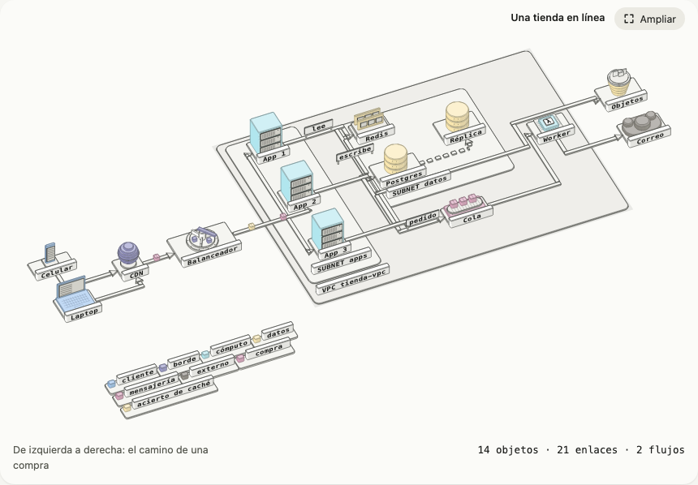
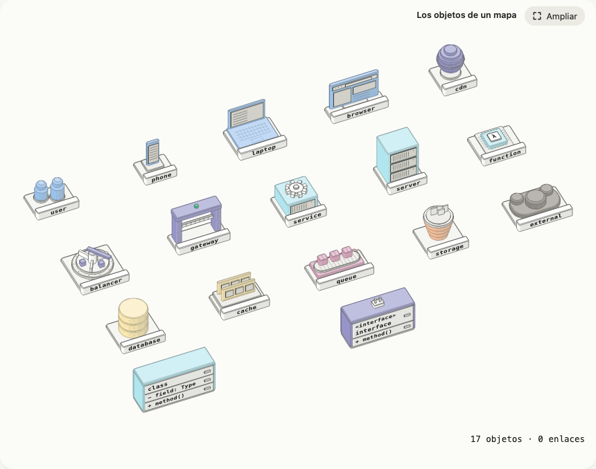
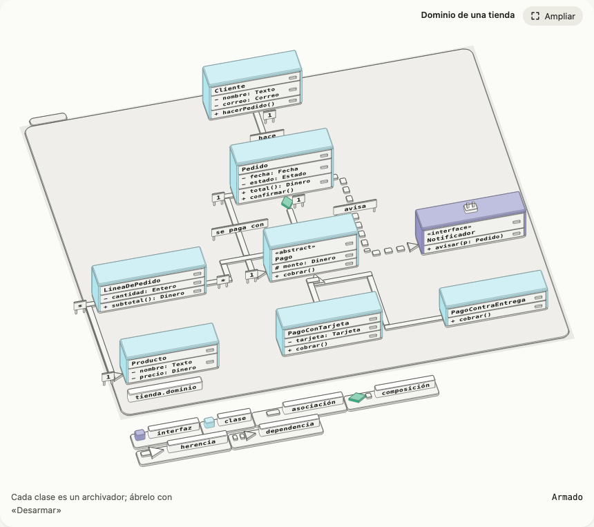
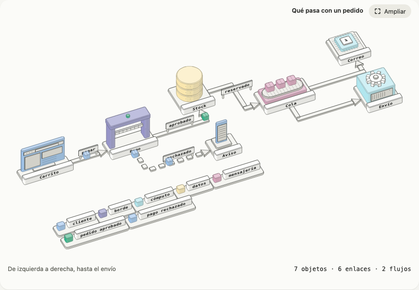
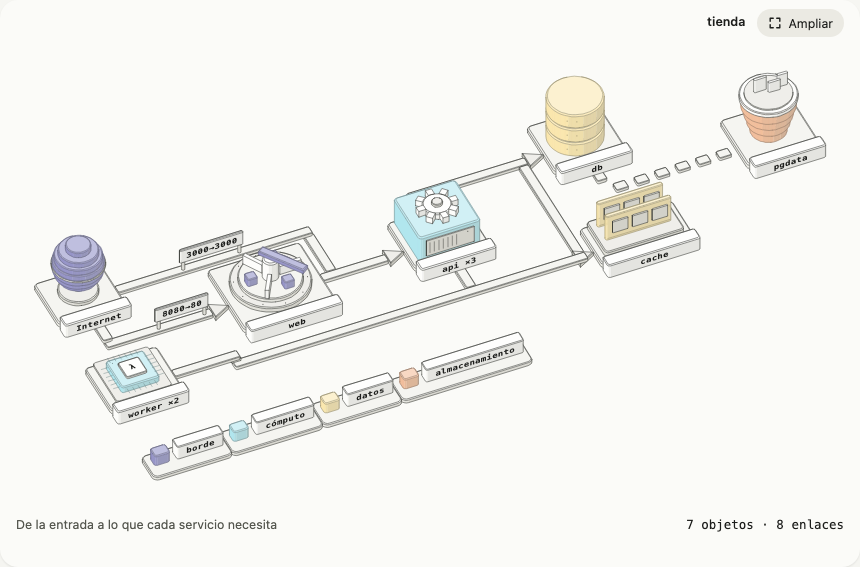

# Mapas: topologías, flujos y UML

Un mapa explica cómo se conectan las cosas (una red, un pedido que va de la tienda al envío, las clases de un dominio)
sin dibujar cajas con flechas. **Cada nodo es un objeto pequeño y reconocible**: un celular en su soporte, un rack, una
base de datos como pila de discos, una cola como cinta transportadora con paquetes, un balanceador como carrusel, una
clase como un archivador con cajones. Lo escribes en JSON anidado, con ejemplos que se entienden, y isofig lo reparte,
traza las cintas por el piso, pone las puntas UML y hace correr los paquetes.



```json
{
  "id": "mapa-minimo",
  "title": { "es": "Un pedido", "en": "An order" },
  "map": {
    "nodes": [
      { "id": "web", "is": "browser", "name": "Tienda" },
      { "id": "api", "is": "service", "name": "API" },
      { "id": "db", "is": "database", "name": "Postgres" }
    ],
    "links": [
      { "from": "web", "to": "api", "label": "pedir" },
      { "from": "api", "to": "db" }
    ],
    "flows": [{ "path": ["web", "api", "db"], "label": "un pedido" }]
  }
}
```

`isofig build mapa.json --format page` lo dibuja tal cual: `renderFigure`, `drawScene` y `validateSpec` aceptan `map`
sin pasos extra. Los ejemplos completos y bilingües están en `examples/`: [`mapa-tienda`](../../examples/mapa-tienda/spec.json)
(una tienda en línea con VPC, subredes, caché, réplica, cola y dos flujos), [`mapa-pedido`](../../examples/mapa-pedido/spec.json)
(del carrito al envío, con la rama de pago rechazado) y [`mapa-uml`](../../examples/mapa-uml/spec.json) (el dominio de
una tienda).

## La forma del JSON

| Campo de `map` | Para qué |
|---|---|
| `nodes` | Los nodos: un objeto del catálogo o un contenedor con `children`. |
| `links` | Las cintas entre nodos. |
| `flows` | Los paquetes que recorren esas cintas. |
| `layout` | `flow` (por defecto), `layers` o `grid`: cómo se reparten los nodos. |
| `legend` | `false` quita la leyenda. Por defecto va si hay más de un color, un flujo o un enlace UML. |
| `labelSize` | Fija el tamaño de los rótulos (unidades del mundo) en vez de dejar que se ajuste solo. |

El resto de la figura (`id`, `title`, `hint`, `caption`, `alt`, `width`, `height`, `camera`) es el de siempre. Un mapa pone
por ti el tamaño (1150 de ancho), la cámara que le sienta a su reparto, una lectura («14 objetos · 21 enlaces · 2
flujos») y una descripción para lectores de pantalla con los objetos y lo que se enlaza con qué: lo que escribas en la
spec manda.

### Nodos

| Campo | Para qué |
|---|---|
| `id` | Único en todo el mapa (también dentro de contenedores). |
| `is` | Un objeto del catálogo (abajo). En un contenedor es su etiqueta: `region`, `vpc`, `subnet`, `cluster`, `package`… |
| `name` | El rótulo grabado, `Text` (`"Redis"` o `{ "es": …, "en": … }`). Por defecto, el `id`. |
| `children` | Hace del nodo un contenedor: una bandeja con su placa, del tamaño de lo que lleva dentro. |
| `paint` | Un rol de color (`client`, `edge`, `compute`, `data`, `messaging`, `storage`, `external`) en vez del que trae el objeto. |
| `layout` | Cómo reparte un contenedor a sus hijos; por defecto, el del mapa. |
| `cell` | En `grid`: `[columna, fila]`. |
| `rank` | En `flow` y `layers`: fuerza el rango (la columna o el nivel). |
| `fields`, `methods`, `abstract`, `stereotype`, `explode` | Clases e interfaces UML: ver abajo. |

### El catálogo



| `is` | Es… | Rol |
|---|---|---|
| `user`, `phone`, `laptop`, `browser` | dos personas de ajedrez; un celular en su soporte; un portátil abierto; una ventana de navegador | `client` |
| `cdn`, `balancer`, `gateway` | un globo sobre su pie; un carrusel de reparto; un portal con barrera | `edge` |
| `service`, `server`, `function` | una caja con un engranaje; un rack de tres unidades; un chip con una λ | `compute` |
| `database`, `cache` | una pila de discos; dos módulos de memoria en su zócalo | `data` |
| `queue` | una cinta transportadora con paquetes | `messaging` |
| `storage` | un balde con archivos asomados | `storage` |
| `external` | una nube | `external` |
| `class`, `interface` | un archivador con cajones de nombre, atributos y métodos; el mismo, con un enchufe encima | `compute`, `edge` |

Cada objeto va sobre un zócalo con una placa de tono neutro donde se graba el nombre; las clases llevan su nombre en el
primer cajón. Un `is` que no está en el catálogo es un error (`map-glyph-unknown`), salvo en un contenedor.

### Contenedores

Un nodo con `children` es una **bandeja baja** con su placa («VPC tienda», «SUBNET apps»): la clase en mayúsculas y el
nombre. Su tamaño sale de sus hijos y cada nivel de anidamiento sube un paso de tono, así se ve qué contiene qué.
`package` le suma la pestaña de carpeta de UML y no repite su clase en la placa. Una cinta que cruza una bandeja corre
sobre la más alta.

```json
{ "id": "vpc", "is": "vpc", "name": "tienda-vpc", "children": [
  { "id": "apps", "is": "subnet", "name": "apps", "children": [
    { "id": "app-1", "is": "server", "name": "App 1" },
    { "id": "app-2", "is": "server", "name": "App 2" }
  ] }
] }
```

## Distribuciones

- **`flow`**: de izquierda a derecha por rangos. El rango de un nodo es el camino más largo hasta él por los enlaces
  (un ciclo se corta donde se cierra); los de un mismo rango se apilan hacia el lector y se ordenan para que las cintas
  se crucen lo menos posible. `rank` lo fuerza.
- **`layers`**: de arriba abajo. La herencia (`inherits`, `implements`) pone al padre arriba; la composición y la
  agregación, al todo; lo demás, al origen. Los hermanos de un nivel quedan uno al lado del otro. Es la del UML.
- **`grid`**: celdas explícitas, `cell: [columna, fila]` (la columna crece a la derecha; la fila, hacia el lector). Un
  nodo sin `cell` toma la primera celda libre; dos en la misma celda avisan (`map-cell-collision`) y el segundo se corre.

Un objeto alto le tapa al de atrás: los nodos se separan lo que haga falta para que el de adelante no cubra el rótulo
del anterior. El reparto de un contenedor puede ser otro que el del mapa (`layout` en el nodo).

La cámara por defecto de cada reparto mira de frente y un poco desde la izquierda (`flow` y `grid`: azimut −24°,
elevación 44°; `layers`: −14°, 46°), de modo que se ven el frente y el costado por donde entran las flechas. Cámbiala con
`camera` como en cualquier figura.

## Enlaces

`{ "from": "a", "to": "b" }`. `from` y `to` aceptan un `id` o una lista (`"to": ["app-1", "app-2"]` son dos cintas); el
rótulo y las multiplicidades van en la primera.

| Campo | Para qué |
|---|---|
| `label` | Un cartel de pie sobre la cinta, en el sitio más despejado. |
| `kind` | `link` (por defecto: una flecha de `from` a `to`) o un enlace UML. |
| `arrow` | `end` (la punta en `to`), `start` (en `from`), `both` o `none`; reemplaza al del `kind`. |
| `dashed` | Cinta discontinua. |
| `mult` | UML: multiplicidad junto a cada extremo, `["1", "*"]`. |
| `paint` | Pinta la cinta con un rol. |

| `kind` | Se dibuja como | Reparto en `layers` |
|---|---|---|
| `link` | flecha hacia `to` | `from` antes |
| `inherits` | triángulo **hueco** en `to` (el padre), que siempre entra por el frente | `to` arriba |
| `implements` | lo mismo, con la cinta punteada | `to` arriba |
| `composes` | rombo **lleno** en `from` (el todo) | `from` arriba |
| `aggregates` | rombo hueco en `from` | `from` arriba |
| `depends` | flecha con la cinta punteada | `from` antes |
| `associates` | cinta lisa (con `arrow: "end"`, una punta) | `from` antes |

Las cintas son ortogonales, van por el piso y rodean a los nodos; salen y llegan por el lado que mira al destino y
prefieren llegar por un lado que se vea. Las que **comparten origen o destino y se dibujan igual** (por ejemplo
`"from": ["app-1", "app-2", "app-3"]`) se juntan en un tronco. Si una cinta no encuentra camino libre se dibuja directa y
`map-route-blocked` lo dice.

### Clases UML

```json
{ "id": "Pedido", "is": "class", "explode": true,
  "name": { "es": "Pedido", "en": "Order" },
  "fields": ["- fecha: Fecha", "- estado: Estado"],
  "methods": ["+ total(): Dinero", "+ confirmar()"] }
```

`fields` y `methods` se graban en el cajón de atributos y en el de métodos (si no hay, el cajón no existe). `abstract:
true` graba `«abstract»` sobre el nombre; `is: "interface"` (o un `stereotype`) lo mismo con `«interface»` y le pone un
enchufe encima. Con `explode: true` el control **«Desarmar»** abre los cajones (primero los atributos, luego los
métodos), y la lista «Pieza» deja elegir «atributos» o «métodos» en todas las clases a la vez.



## Flujos

```json
{ "id": "compra", "path": ["celular", "cdn", "lb", "app-1", "cola"], "label": "compra", "every": 3, "paint": "messaging" }
```

Un flujo recorre los nodos de `path` en orden, **sobre la cinta de cada tramo** (si no hay enlace entre dos nodos
seguidos, se crea). Lo que viaja son paquetes, parejos a `every` segundos (se ajusta para que queden iguales);
`speed` son unidades del mundo por segundo (80 por defecto), `delay` los segundos que espera el primero y `paint` su
color (sin él, el acento). El paquete se apaga mientras pasa por dentro de un objeto y vuelve a aparecer por el otro
lado. Cada paquete es un grupo con su recorrido: son [`tracks`](spec.md#recorridos) de la spec. Con el botón de pausa se
detienen y con movimiento reducido quedan quietos a mitad de camino y a la vista.



## Color, leyenda y rótulos

- **Cada objeto trae su rol de color** (tabla del catálogo) y la leyenda al frente del mapa nombra los que aparecen, los
  flujos con su paquete y, en UML, las puntas. El color nunca es el único portador del significado: cada objeto tiene su
  forma y su nombre en una placa de tono neutro.
- **La paleta pide como mucho seis colores** (los grises son uno) y que ningún par se confunda con daltonismo (ver
  [color.md](color.md)). Un mapa con los siete roles avisa: agrupa roles con `paint` (por ejemplo el almacenamiento de
  objetos como `data`) o deja alguno en gris. Los paquetes pueden usar el color de un rol que ya está en el mapa.
- **Las cintas y las puntas no se pintan**: tonos neutros, la punta de una flecha en el más oscuro, la herencia hueca y
  solo el rombo lleno con el acento.
- **Los rótulos se ajustan solos**: el compilador busca el menor tamaño con el que la letra mide unos 10 px en la vista
  ampliada («Ampliar», a unos 1150 px). A 390 px un mapa no se lee y no pretende leerse. Con demasiados nodos para una
  figura el tamaño no alcanza y avisa (`map-label-small`): parte el mapa en dos.

## Importar

```sh
docker compose config --format json | npx isofig import compose - -o stack.json
npx isofig import mermaid diagrama.mmd -o mapa.json      # o «-» para leer de la entrada estándar
```

**Mermaid.** Un subconjunto de `flowchart` / `graph` y de `classDiagram`:

| En Mermaid | En el mapa |
|---|---|
| `flowchart LR`, `graph TD` | `layout: flow` (`RL` también) o `layers` (`TB`, `BT`) |
| `A[Texto]`, `A(…)`, `A([…])`, `A{…}`, `A((…))`, `A[(…)]`, `A>…]` | un nodo cuyo objeto sugiere su rótulo (Postgres → base de datos, Redis → caché, Kafka → cola, S3 → balde…); si no hay pista, la forma (`[( )]` base de datos, `(( ))` persona, `{ }` portal, `>` cola); si no, `service` |
| `-->`, `---`, `-.->`, `==>`, `<-->`, `-->|texto|`, `-- texto -->` | un enlace (con `arrow`, `dashed` y `label`) |
| `A --> B & C`, `A & B --> C` | un enlace por par |
| `subgraph id [Título] … end` | un contenedor |
| `class A { +campo  +metodo() }`, `A : +campo`, `<<interface>>`, `<<abstract>>` | una clase o interfaz con sus cajones (lo que lleva `(` es un método) |
| `A <\|-- B`, `A *-- B`, `A o-- B`, `A --> B`, `A ..> B`, `A ..\|> B`, `A "1" --> "*" B : texto` | `inherits`, `composes`, `aggregates`, `associates`, `depends`, `implements`, con multiplicidades y rótulo |

Lo demás (estilos, `click`, `classDef`, secuencias…) se salta y la CLI lo lista en `skipped:`. `RL` y `BT` se dibujan
como `LR` y `TD`. Con una API: `fromMermaid(texto)` devuelve la spec y `fromMermaidDetailed(texto)` también las líneas
saltadas.

**docker compose.** Cada servicio es el objeto que sugiere su imagen (`postgres` → base de datos, `redis` → caché,
`nginx` → balanceador, `worker` → función, lo demás → servicio), `depends_on` son cintas de quien necesita a lo que
necesita, los puertos publicados entran desde un globo «Internet» con su `8080→80`, y cada volumen con nombre es un
balde al que apunta una cinta punteada. Las réplicas van en el rótulo («api ×3»). Es una spec normal: edítala.



## Validación y límites

`validateSpec` revisa el `map` con códigos `map-*`: ids de nodo repetidos, enlaces o flujos hacia nodos que no existen,
un `is` desconocido, un reparto, un tipo de enlace o una pintura que no son, y celdas repetidas ([validar.md](validar.md)).
Con un mapa, `renderFigure` suma `map-label-small` y `map-route-blocked`, y todo lo demás de la auditoría habla del
árbol que sale del mapa: sus rutas apuntan a `root.children[…]`.

- Los `id` de nodo son libres, pero `_links`, `_flows` y `_legend` son de las piezas que genera el compilador.
- Las cintas que tienen que cruzarse se cruzan, sin puente; un mapa con más de unos veinte nodos pide partirse.
- El compilador corre en el navegador (el giro lo necesita para volver a dibujar): `isofig/map` exporta `compileMap` y
  `resolveMap`. El giro no lo trae por defecto, para no pesar en las figuras sin mapa: si usas `enableOrbit` con un
  mapa, pásale `resolveMap` (el adaptador de Astro lo hace solo).
- La vista previa del CLI con `--orbit` necesita la spec en un `.ts`.
